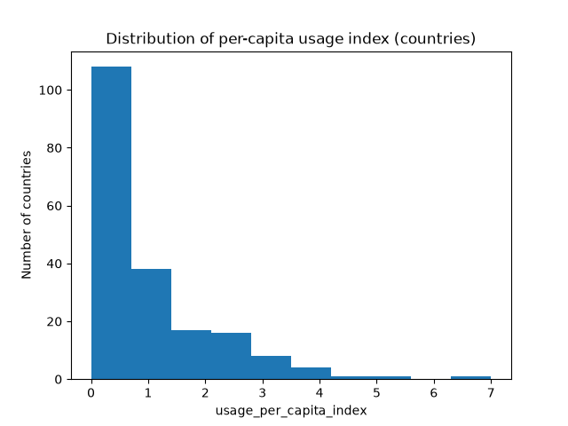
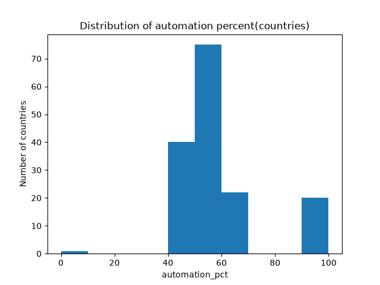
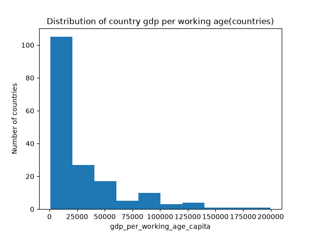
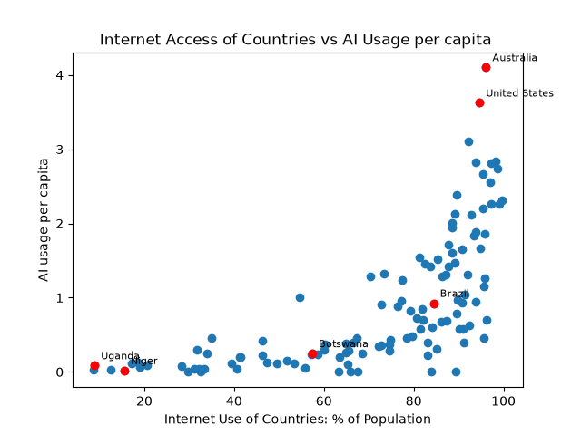
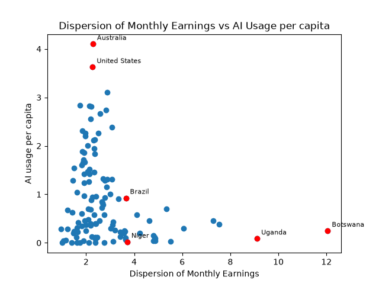
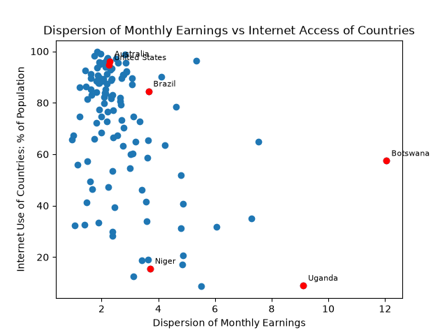

# Exploratory Profile

## Per-capita usage index (adoption outcome)

There is a strong right-skew in this histogram, with a majority of countries being under the usage_per_capita_index of 1. 
There is a long tail with Israel being the only country near 7. A transformation may be needed before modeling it.

## Automation vs augmentation (behavioral outcome)

A majority of countries sit between 40% and 60% automation. With a few sitting at 100% such as Guyana, Burundi, Chad, Sierra Leone, and others. Andorra sits at 0, being the only country with a 0% automation. Mostly it is central but with some outliers due to low-usage from countries.

## GDP per working-age capita (key predictor)

Over 100 countries have a gdp below 25,000. This makes the histogram strongly right skewed, similar to the per capita usage index. 
The long tail includes countries such as Luxembourg, Ireland, Switzerland, and the United States.

# Exploratory Data Analysis on Merged Dataset

## Comparing Country's Internet Usage (% of the population) vs AI Usage Per Capita

With the plot, as the internet use of a country increases based upon the % of population, the AI usage per capita also increases. It is important to note that there is an explosion of growth after 80% internet use. An example of this is Niger, which has an internet usage rate below 20% and an AI usage per capita of only 0.01981. The inverse are countries such as the United States and Australia, with almost 100% internet usage and AI usage per capita above 3. 

## Comparing Country's Dispersion of Monthly Earnings vs their AI Usage Per Capita

A majority of the countries fall between a dispersion of 0 and 6. There is not as much of a relationship to be seen between the Dispersion of Monthly earnings and AI usage per capita compared to that of the internet use. The top countries by AI usage per capita do not change, but they have similar dispersion of monthly earnings as countries with low usage per capita. The biggest outlier is at 12, which is the country of Botswana. 

## Comparing Dispersion of Monthly Earnings vs Internet Usage (% of the population)

There is a conglomeration of countries within the upper left section of the plot. A decent amount of countries have similar dispersion of monthly earnings and internet access. Australia and the United States fall in the same place within this plot. There are a few outliers, such as Botswana which has a large dispersion of monthly earnings and an internet access percentage of over 50. It could be seen as a negative relationship, as the smaller the dispersion, the higher internet use of the country.

## Summary

Comparing all three variables, the strongest relationship is between a Country's Internet Use and their AI Usage Per Capita. It is a strong, positive, non-linear relationship that sharply increases after 80% population usage. Since there is a skew present, the use of a transformation may be helpful before moving into the regression portion. With the wage dispersion, there is not as strong of a relationship as countries with both a high and low usage per capita have similar dispersion values. When comparing the two predictors, there is a moderate, negative relationship between them. A negative relationship between predictors would impact the regression because there is some form of correlation, so it is important to keep this in mind. 